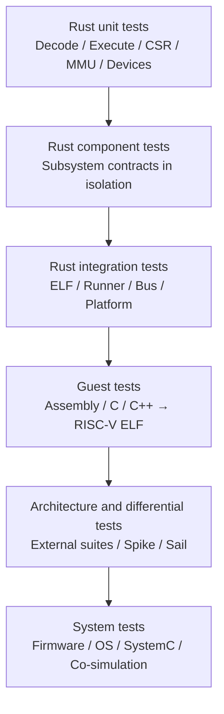

# Verification Architecture

**Status:** Current

**Authority:** Normative for test-layer ownership; individual tool integrations require their own verified setup

**Last reviewed:** 2026-10-11

## Test layers

Passing a lower layer does not imply a higher layer is integrated. In particular, a component test for an ISA extension, MMU, peripheral, or TLM object is not an end-to-end product-support claim.

## Language policy

Test language follows the layer rather than the simulator implementation language:

| Layer | Expected languages |
| --- | --- |
| Simulator unit/component/integration | Rust, plus property-test and benchmark crates |
| Guest program | RISC-V assembly, C, or C++ |
| External architecture suite | Whatever the upstream suite and toolchain require |
| Orchestration and comparison | Rust, Python, shell, or upstream tooling |
| SystemC/TLM and EDA integration | C++ plus any vendor-required languages |

## Current repository inventory

- Rust tests live under `src/**` and `tests/*.rs`.
- Project-authored guest programs currently live under `tests/bare-metal-riscv-test/` and are assembly sources.
- CI installs a RISC-V GNU assembler/linker, runs the Rust quality gate, and on pull requests and on pushes to `main` builds and runs the project-authored ELF programs, including the Stage 4 `s4_*` guests.
- CI runs debug mutation controls with `python3 scripts/verify_stage6_mutations.py --source-ref HEAD` and tool integration with `scripts/debug_attach.sh --require-spike`. The mutation runner uses disposable storage outside the checkout and writes diagnostics to the CI log.
- Execution results belong in CI logs/artifacts and PR discussions. This document defines verification ownership and commands; it is not a run ledger.
- CI job `debug-attach` builds the development image from the `Dockerfile` and runs `scripts/debug_attach.sh --require-spike` inside it. The saved session and the Spike comparison are in [stage6-exit.md](stage6-exit.md).
- Commit-log comparison helpers exist, but the log currently omits memory-access records in the public ELF run loop.
- No external RISC-V architecture suite is treated as integrated merely because documentation mentions it.

## Verification documents

- [A1 acceptance and closeout](a1-acceptance-assessment.md) — completed baseline, explicit limitations and the bounded A2 handoff
- [A2 acceptance and closeout](a2-capability-assessment.md) — completed flat-library workflow, explicit limitations and the A3 handoff
- [A3 acceptance and closeout](a3-capability-assessment.md) — completed shared placement and result construction, explicit limitations and the A4 handoff
- [A4 acceptance and closeout](a4-capability-assessment.md) — shared run control and installation; closeout and A5 contract approved in PR #31
- [A5 capability assessment and closeout](a5-capability-assessment.md) — approved frozen profile, final 51/51 selected external passes and negative controls; formally closed out in PR #37
- [A1 public behavior compatibility matrix](public-behavior-matrix.md) — CLI/ELF and flat-library inventory plus persistent second-batch tests
- [A1 public behavior defect and gap register](public-behavior-gaps.md) — bounded reproductions and unverified limits
- [Project-authored bare-metal tests](bare-metal-tests.md)
- [A6 capability and acceptance assessment](a6-capability-assessment.md)
- [A6 retained A5 ACT4 replay summary](a6-act4-replay-35325844246.json)
- [A7 T1 non-atomic physical contract](a7-physical-contract.md) — vocabulary and focused validation boundary; not native/Hart integration
- [A7 T2 native target adapters](a7-native-targets.md) — shared native RAM/UART/HTIF component adapters; not Hart/public-facade migration
- [A7 T3 Hart physical wiring and legacy bridge](a7-hart-physical.md) — ordinary Hart routes, lock order, and retained legacy atomic boundary
- [A7 T4 public-facade equivalence](a7-public-equivalence.md) — CLI/library workflow matrix, route audit, and bounded compatibility exceptions
- [A7 T5 final verification and bounded closeout evidence](a7-capability-assessment.md) — §8 matrix, exact-head Rust/ELF/ACT4 evidence, cumulative independent review outcome, residual debt, and explicit rolling-transition boundary
- [A7 bounded closeout record](../archive/milestones/a7-closeout-record.md) — six-item acceptance, PR/source identities, two independent 51-case scopes, replay/tool limits, and next-roadmap boundary
- [A7 ACT4 offline replay](a7-act4-replay-35432032788.json) — compact digest-bound replay of the fresh 51-case artifact
- [A7 performance observation](a7-performance-observation.json) — bounded current-head Criterion observations; no regression claim
- [A7 public-facade physical-loop observation](a7-physical-loop-observation.json) — pre-migration/current public `load_and_run` measurements with guest-result and retirement checks
- [A7 cumulative T5 review checklist](a7-t5-cumulative-review-checklist.md) — source/test dependencies and independent-review boundary for the final PR head
- [A8 T4 public atomic bridge exit and equivalence](a8-public-atomic.md) — standard-facade route audit, cross-facade atomic guests, P2a visibility, D-c boundaries, and no-closeout evidence
- [A8 T5 earlier-head evidence and acceptance audit](a8-t5-evidence.md) — historical checks bound to `45a170f`, explicitly stale for later implementation heads
- [A8 bounded closeout assessment](a8-closeout-assessment.md) — current A8 implementation-tree evidence, T0–T5 matrix, 58 fresh project guests, separate frozen ACT4 51-case run, and residual limitations; not A9 implementation evidence
- [A9 T0–T3 checkpoints and local T4 progress](a9-stage2-progress.md) — frozen route inventory, Hart facts, direct-owner lifecycle, public-facade migration and R1–R4 reproductions
- [A9 bounded acceptance assessment](a9-closeout-assessment.md) — cumulative audit, preserved checkpoint, separate final PR-head gate/review and exact merged-main CI; 58 fresh project CLI guests, Coverage skipped
- [A9 implementation closeout record](../archive/milestones/a9-closeout-record.md) — technical acceptance 2026-10-02, closeout documents delivered 2026-10-03, approved rotation; formal completion effective on actual merge
- [System Bus Access Debug contract](../dev-plan.md) — owner-approved D1–D10, sole Current on the successor rotation merge. Its units are implementation requirements, not runtime support claims.
- [Entire approved Program-buffer Debug Execution contract](../archive/milestones/program-buffer-debug-execution.md) — preserved bounded program-buffer scope and limitations; historical on rotation. Implementation is PR #114 through PR #118, completed 2026-10-30. CI and PR history retain execution/review outcomes.
- [Approved SBA proposal entry](../proposals/post-program-buffer-sba.md) — informational pointer to the normative contract.
- [Entire approved Stage 6 contract](../archive/milestones/stage6-riscv-debug-mode.md) — preserved abstract-command debugger scope and limitations; historical since the PR #108 rotation. CI and PR history retain execution/review outcomes.
- [Entire approved Stage 5 contract archive](../archive/milestones/stage5-platform-interrupts-wfi-and-counters.md) — decisions D0–D9 were owner approved, recommended option, on 2026-10-16 13:08 CST. Implementation is PR #90 through PR #94. Full body preserved. Formal completion took effect on the PR #96 activation merge.
- [Entire approved Stage 4 contract archive](../archive/milestones/stage4-virtual-memory-and-protection.md) — decisions recorded by PR #75, owner-authorized activation 2026-10-11 UTC, implementation and review at PR #88. Full body preserved. Formal completion on the Stage 4 to Stage 5 rotation merge.
- [Stage 5 approved informational snapshot](../proposals/stage5-contract-draft.md) — decided drafting record. Not a second Current contract and not an implementation.
- [Entire approved A10 contract archive](../archive/milestones/a10-independent-public-path-performance-test-infrastructure.md) — activated by PR #71 on 2026-10-08, implemented by PR #72 `5d23d33`; full body preserved, formal completion on the rotation merge
- [A10 approved informational snapshot](../proposals/a10-performance-test-infrastructure.md) — full drafting history, original approval-request wording is historical; not a second contract or implemented facility
- [A10 infrastructure progress](a10-stage3-progress.md) — P0/P1/P2 exact-head checkpoints and reviews, P3′ baseline delivery, P4′ close-out status and the deferred-certification rationale with reasons
- [A10 baseline v1 observation](a10-baseline.md) — exactly three representative workloads; original Darwin record kept, plus the merged-main re-run and the Linux/x86_64 session after the per-platform pin; informational host-cost observations, never a speed/regression gate
- [A10 public-path evidence schema](a10-perf-schema.md) — `ruscv-perf/1` format, command statuses and the deferred certification boundary (calibration series deleted 2026-10-10)
- [A10 duration-scaled calibration workloads](a10-calibration-workloads.md) — historical; series deleted 2026-10-10, fixture sources retained
- [A10 implementation closeout record](../archive/milestones/a10-closeout-record.md) — bounded technical acceptance 2026-10-10; criterion to commit evidence, merged-main baseline re-run, limitations and re-evaluated unfinished work. The independent final PR-head review returned APPROVE for `c4fda56`.
- [A10 documentation-rotation audit](a10-contract-rotation.md) — historical audit of the A9 to A10 rotation; no runtime or performance claims
- [Stage 4 documentation-rotation audit](stage4-contract-rotation.md) — historical audit of the A10 to Stage 4 rotation; the promoted-text check is pinned to `9f6f678`
- [Stage 5 documentation-rotation audit](stage5-contract-rotation.md) — historical audit of the Stage 4 to Stage 5 rotation; the promoted-text check is pinned to `02f20b1`
- [Stage 6 documentation-rotation audit](stage6-contract-rotation.md) — whole-contract preservation of Stage 5 and a bounded check of the Stage 6 contract; no runtime or performance claims
- [Stage 4 final review](stage4-final-review.md) — §7 item 10 review of Sv39, privilege, CSRs, traps, delegation, MPRV, and SFENCE.VMA
- [Stage 5 final review](stage5-final-review.md) — §7 item 9 review of the clock, MSIP and MTIP, PLIC source 1, WFI, and the public exit, read at `fb8399b`
- [Stage 5 public exit](stage5-exit.md) — §7 checks 1 through 8 for the implementation, and the pointer to the item 9 review
- [Stage 4 progress and closeout](stage4-closeout.md) — oracle-digest decision, CI gate, review pointer, and local gate evidence; not a formal completion
- [A9 T4 source/tool/artifact and per-case evidence](a9-t4-guest-evidence.json) — self-contained checkpoint execution record; not ACT4 or milestone certification
- [External RISC-V test integration contract](external-riscv-tests.md)
- [Commit tracing and differential testing](commit-tracing.md)

The A1 matrix and gap register are current as-of evidence records, not an A1
closeout and not a claim that component tests or old CI/reference logs prove
public-path support. The A7 and A8 closeout records are bounded evidence; neither
certifies unrelated components. PR #69 delivered A9 on 2026-10-02 with final PR-head verification/review and separate successful merge-head CI. PR #70 delivered closeout documents on 2026-10-03 with document-head checks/static review and distinct synthetic PR-checkout CI, not new direct-head runtime evidence. A9 was formally completed by PR #71 and [its entire contract is archived](../archive/milestones/a9-hart-facts-safe-n1-machine-lifecycle.md). A10 was activated by that same PR. The Stage 4 decisions were recorded by PR #75, and activation is the owner-authorized activation of 2026-10-11 UTC. On the A10 to Stage 4 rotation merge A10 was formally completed and [its entire contract is archived](../archive/milestones/a10-independent-public-path-performance-test-infrastructure.md). Stage 4 implementation and review are recorded at PR #88. On the Stage 4 to Stage 5 rotation merge [Stage 4](../archive/milestones/stage4-virtual-memory-and-protection.md) was formally completed and archived, and Stage 5 became sole Current. The Stage 5 to Stage 6 rotation merged in PR #96 as `a8851c4ac57500eb54dadc89919cd7314b626594` at 2026-10-19T13:49:34Z. That merge formally completed and archived [Stage 5](../archive/milestones/stage5-platform-interrupts-wfi-and-counters.md), and made Stage 6 sole Current. The Stage 6 successor rotation merged in PR #108 as `4933eb62060fef0a19f6d58517ce651c927f2cc1` at 2026-10-28, making the [entire Stage 6 contract](../archive/milestones/stage6-riscv-debug-mode.md) historical and Program-buffer Debug Execution sole Current. Program-buffer implementation is PR #114 through PR #118, completed 2026-10-30 at merge head `3085f9e`. On the owner-approved SBA rotation, the [entire Program-buffer Debug Execution contract](../archive/milestones/program-buffer-debug-execution.md) becomes historical and [System Bus Access Debug](../dev-plan.md) becomes the sole Current target. Activation implements no new instruction or debugger feature. The [Stage 5 snapshot](../proposals/stage5-contract-draft.md) is not a second Current contract.
Checkpoint JSON is not relabeled as final-head execution; no new ACT4 or performance result.
The matrix records the exact revision, the initial host
limitation, and the successful Docker-based guest evidence for its batch.
The [A1 closeout](../archive/milestones/a1-closeout-record.md) additionally records
exact-merge main CI with guest compilation and 46/46 execution; historical
batch observations are not rewritten as new runs.

Historical test proposals are retained under [`../archive/designs/`](../archive/designs/).
