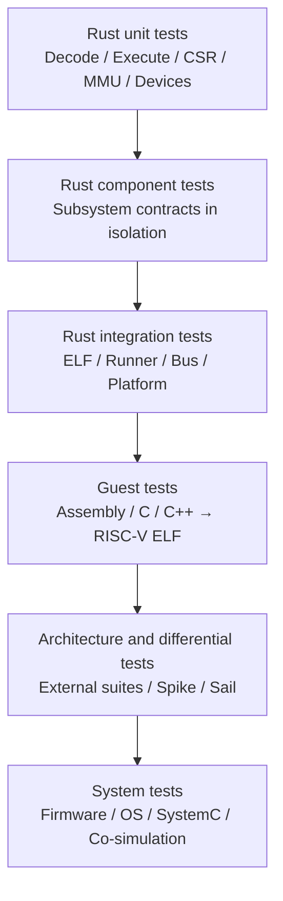

# Verification Architecture

**Status:** Current

**Authority:** Normative for test-layer ownership; individual tool integrations require their own verified setup

**Last reviewed:** 2026-11-08

## Test layers

Passing a lower layer does not imply a higher layer is integrated. In particular, a component test for an ISA extension, MMU, peripheral, or TLM object is not an end-to-end product-support claim.

## Language policy

Test language follows the layer rather than the simulator implementation language:

| Layer | Expected languages |
| --- | --- |
| Simulator unit/component/integration | Rust, plus property-test and benchmark crates |
| Guest program | RISC-V assembly, C, or C++ |
| External architecture suite | Whatever the upstream suite and toolchain require |
| Orchestration and comparison | Rust, Python, shell, or upstream tooling |
| SystemC/TLM and EDA integration | C++ plus any vendor-required languages |

## Current repository inventory

- Rust tests live under `src/**` and `tests/*.rs`.
- Project-authored guest programs currently live under `tests/bare-metal-riscv-test/` and are assembly sources.
- CI installs a RISC-V GNU assembler/linker, runs the Rust quality gate, and on pull requests and on pushes to `main` builds and runs the project-authored ELF programs, including the Stage 4 `s4_*` guests. Every guest then runs four more times, under `--transport tlm`, under `--transport tlm --dmi`, under `--transport tlm --quantum 1` and under `--transport tlm --quantum 1024`, each with its declared profile and the same cycle bound; every pass is classified exactly like the native pass, so a guest that fails only there fails the suite. The parity set named by the blocking-transport contract, extended by the direct-memory self-modifying-code and page-table guests, compares each pass's `--log-commits` output byte for byte with the native one, and one `--dmi --quantum 1024` run must report fewer syncs than completed turns.
- CI runs debug mutation controls with `python3 scripts/verify_stage6_mutations.py --source-ref HEAD` and tool integration with `scripts/debug_attach.sh --require-spike`. The mutation runner uses disposable storage outside the checkout and writes diagnostics to the CI log; its 180 units include the quantum negative controls of the archived quantum contract, the fifteen suspension and C ABI controls of the archived non-blocking contract, among them the CLI refusal of `--quantum` without the TLM route, the seven `device-u1-*` controls of the archived TLM-Modeled Devices contract's device path, which pin the UART transmit reporting, the two publication sinks, the typed byte write, the in-tree HTIF read and the RAM adapter's rejection of a device event, and the ten `device-u2-*` controls of the host device target, which pin the UART route selection, event publication on accept and on fault, the unknown-completion precedence, the zero delay, host elapsed and `dmi_allowed` checks, the SBA initiator, the native and flat refusals, the per-build transport reset and the host-served `uart_inspection`, and the two `device-u3-*` controls of the C ABI device table, which pin the attached table's storage in the handle and the copied device-event tag. The four `htif-u1-*` controls of the Host HTIF Service contract's Rust unit pin the host HTIF selection, the per-build transport reset and its UART-then-HTIF order, the rule that a device event on a read is a protocol failure on both windows, and the rule that an HTIF event value must equal the request's eight data bytes; the contract's fifth control, `htif-u2-window`, remains a requirement in `docs/dev-plan.md` §4 until its C ABI unit implements it. It also holds the `sc_stop` control's Rust stand-in; the `SystemC transport smoke` job runs that control's early-`sc_stop` variant, which must not pass. The debug-attach sessions include `ruscv-direct-mem`, which inserts, hits and removes a software breakpoint through forced system-bus access under `--transport tlm --dmi`, and `ruscv-quantum`, which reads `mtime` by system-bus access before and inside a `--quantum 1024` quantum and asserts the D8 bound on the guest's recorded interrupt lateness.
- CI job `Quality and tests` also builds the `capi` static library and compiles and links a plain-C host against it with `scripts/test_capi_smoke.sh`, so the C ABI needs no C++ toolchain and `cargo build`/`test --all-features` still do not. The same job runs the A10 producer-pin suite under `tools/a10`.
- CI job `SystemC transport smoke` builds the development image, whose SystemC layer pins Accellera SystemC 3.0.2 at commit `70b0fc8e4a74acc677b0fc73cea08f940c2115d5` with C++17, and runs `scripts/test_systemc_smoke.sh` inside it: `atomic_tohost_exit` and `fd_fma` through the pinned kernel, the C ABI and the RAM target, compared against the native CLI for exit code and commit log; both guests run again under `--dmi` with the target's `b_transport` count strictly below the non-direct pass, one guest runs under `--dmi-invalidate-every` with an unchanged commit log and verified invalidation counts, both guests run at `--quantum 1` and `--quantum 1024` with and without `--dmi` under one kernel-clock check per grant and a `--quantum 1024` grant count strictly below the `--quantum 1` pass, both guests run under `--nb` on all five return paths at zero and 1.5-tick latency with `--grant-trace` traces compared against parity, equal `BEGIN_REQ` and applied-access counts and the D10 sums, the `--dmi` AT passes compare with their parity traces and serve fewer transactions, the `--nb --quantum` refusal and non-blocking usage errors are required, the two quantum fault-option controls run under `--quantum 1024` and must each fail with its own named diagnostic, and the five non-blocking fault options run in their stated mode with their own assertion and are usage errors in the wrong mode, while no normal `--nb` pass may report a late phase. `hello` runs under `--uart-target in-tree` and `--uart-target host` at the baseline, with `--dmi`, with `--nb` and with `--quantum 1024`: both selections must keep the native exit code and commit log, the in-tree pass must report zero host device transactions, the host pass must report a non-zero transaction count equal to its reads plus writes and transmit exactly `Hello!\n` on the target's `uart-console:` channel, and a repeated host pass must produce identical bytes, log and exit code. The two existing guests run again under `--uart-target host` with zero device transactions, and the three device fault options run in their stated mode, each failing with its own assertion and each a usage error without `--uart-target host`.
- Execution results belong in CI logs/artifacts and PR discussions. This document defines verification ownership and commands; it is not a run ledger.
- CI job `debug-attach` builds the development image from the `Dockerfile` and runs `scripts/debug_attach.sh --require-spike` inside it. The saved session and the Spike comparison are in [stage6-exit.md](stage6-exit.md).
- Commit-log comparison helpers exist, but the log currently omits memory-access records in the public ELF run loop.
- No external RISC-V architecture suite is treated as integrated merely because documentation mentions it.

## Verification documents

- [A1 acceptance and closeout](a1-acceptance-assessment.md) — completed baseline, explicit limitations and the bounded A2 handoff
- [A2 acceptance and closeout](a2-capability-assessment.md) — completed flat-library workflow, explicit limitations and the A3 handoff
- [A3 acceptance and closeout](a3-capability-assessment.md) — completed shared placement and result construction, explicit limitations and the A4 handoff
- [A4 acceptance and closeout](a4-capability-assessment.md) — shared run control and installation; closeout and A5 contract approved in PR #31
- [A5 capability assessment and closeout](a5-capability-assessment.md) — approved frozen profile, final 51/51 selected external passes and negative controls; formally closed out in PR #37
- [A1 public behavior compatibility matrix](public-behavior-matrix.md) — CLI/ELF and flat-library inventory plus persistent second-batch tests
- [A1 public behavior defect and gap register](public-behavior-gaps.md) — bounded reproductions and unverified limits
- [Project-authored bare-metal tests](bare-metal-tests.md)
- [A6 capability and acceptance assessment](a6-capability-assessment.md)
- [A6 retained A5 ACT4 replay summary](a6-act4-replay-35325844246.json)
- [A7 T1 non-atomic physical contract](a7-physical-contract.md) — vocabulary and focused validation boundary; not native/Hart integration
- [A7 T2 native target adapters](a7-native-targets.md) — shared native RAM/UART/HTIF component adapters; not Hart/public-facade migration
- [A7 T3 Hart physical wiring and legacy bridge](a7-hart-physical.md) — ordinary Hart routes, lock order, and retained legacy atomic boundary
- [A7 T4 public-facade equivalence](a7-public-equivalence.md) — CLI/library workflow matrix, route audit, and bounded compatibility exceptions
- [A7 T5 final verification and bounded closeout evidence](a7-capability-assessment.md) — §8 matrix, exact-head Rust/ELF/ACT4 evidence, cumulative independent review outcome, residual debt, and explicit rolling-transition boundary
- [A7 bounded closeout record](../archive/milestones/a7-closeout-record.md) — six-item acceptance, PR/source identities, two independent 51-case scopes, replay/tool limits, and next-roadmap boundary
- [A7 ACT4 offline replay](a7-act4-replay-35432032788.json) — compact digest-bound replay of the fresh 51-case artifact
- [A7 performance observation](a7-performance-observation.json) — bounded current-head Criterion observations; no regression claim
- [A7 public-facade physical-loop observation](a7-physical-loop-observation.json) — pre-migration/current public `load_and_run` measurements with guest-result and retirement checks
- [A7 cumulative T5 review checklist](a7-t5-cumulative-review-checklist.md) — source/test dependencies and independent-review boundary for the final PR head
- [A8 T4 public atomic bridge exit and equivalence](a8-public-atomic.md) — standard-facade route audit, cross-facade atomic guests, P2a visibility, D-c boundaries, and no-closeout evidence
- [A8 T5 earlier-head evidence and acceptance audit](a8-t5-evidence.md) — historical checks bound to `45a170f`, explicitly stale for later implementation heads
- [A8 bounded closeout assessment](a8-closeout-assessment.md) — current A8 implementation-tree evidence, T0–T5 matrix, 58 fresh project guests, separate frozen ACT4 51-case run, and residual limitations; not A9 implementation evidence
- [A9 T0–T3 checkpoints and local T4 progress](a9-stage2-progress.md) — frozen route inventory, Hart facts, direct-owner lifecycle, public-facade migration and R1–R4 reproductions
- [A9 bounded acceptance assessment](a9-closeout-assessment.md) — cumulative audit, preserved checkpoint, separate final PR-head gate/review and exact merged-main CI; 58 fresh project CLI guests, Coverage skipped
- [A9 implementation closeout record](../archive/milestones/a9-closeout-record.md) — technical acceptance 2026-10-02, closeout documents delivered 2026-10-03, approved rotation; formal completion effective on actual merge
- [Host HTIF Service contract](../dev-plan.md) — D1–D10 approved 2026-11-08 under delegated planning authority, sole Current on the devices successor rotation merge. Scope only: no unit is implemented, no host HTIF runtime support is claimed, and the host HTIF window, `--htif-target`, the new guest and the three HTIF fault options remain requirements. The device evidence in the next entry is the inherited base.
- [Approved host HTIF service proposal entry](../proposals/post-devices-host-htif.md) — informational pointer to the normative contract.
- [Archived TLM-Modeled Devices contract](../archive/milestones/tlm-modeled-devices.md) — D1–D10 approved 2026-11-07, completed 2026-11-08 at PR #236. Units U1–U4 were implemented by PR #232 through PR #235: the in-tree UART and HTIF device targets and their publication sinks by `src/blocking/device_tests.rs`, `src/executor_device_tests.rs` and `src/machine/tests.rs`; the host target, its refusals, host views and reset also by `src/machine/tests.rs`; the C ABI device table, attach entry and layout pins by `src/capi/tests.rs`, `tests/capi/smoke.c` and `scripts/test_capi_smoke.sh`; `--uart-target` and the three device fault options by `scripts/test_systemc_smoke.sh` in the `SystemC transport smoke` job. Nineteen `device-u1-*`/`device-u2-*`/`device-u3-*` controls in `scripts/debug/stage6-mutations/cases.json` are its mutation-runner coverage. U5 was the exit — documentation and the acceptance mapping, with no behavior change. Runtime support is bounded to what those tests show; the guest suite's TLM passes remain the architectural parity evidence.
- [Historical TLM-modeled devices proposal entry](../proposals/post-nb-tlm-devices.md) — informational pointer to the archived contract.
- [Archived non-blocking contract](../archive/milestones/non-blocking-tlm-transport.md) — entire contract, completed 2026-11-07 at PR #225. Its Rust, C ABI and SystemC units are implemented: Rust suspension, host elapsed time and the D4 response rules are covered by `src/blocking/tests.rs` and `src/machine/tests.rs`; the C ABI fields, grant elapsed rule and layout pins by `src/capi/tests.rs` and `tests/capi/smoke.c` through `scripts/test_capi_smoke.sh`; the SystemC base protocol, AT target mode, timeout, retirement, drain and the five fault options by `scripts/test_systemc_smoke.sh` in the `SystemC transport smoke` job. Fifteen `nb-u1-*`/`nb-u2-*` controls in `scripts/debug/stage6-mutations/cases.json` are the mutation-runner coverage.
- [Historical non-blocking proposal entry](../proposals/post-quantum-nb-transport.md) — informational pointer to the archived contract.
- [Archived quantum contract](../archive/milestones/quantum-temporal-decoupling.md) — entire contract, completed 2026-11-06 at PR #214.
- [Historical quantum proposal entry](../proposals/post-dmi-quantum.md) — informational pointer to the archived contract.
- [Archived direct-memory contract](../archive/milestones/tlm-direct-memory-interface.md) — entire contract, completed 2026-11-06 at PR #199.
- [Historical direct-memory proposal entry](../proposals/post-tlm-dmi.md) — informational pointer to the archived contract.
- [Archived blocking-transport contract](../archive/milestones/blocking-tlm-systemc-transport.md) — completed 2026-11-05 at PR #186.
- [Historical blocking-transport proposal entry](../proposals/post-gc-blocking-tlm.md) — informational pointer to the archived contract.
- [Archived RV64GC default-profile contract](../archive/milestones/rv64gc-default-profile.md) — completed 2026-11-04 at PR #171.
- [Entire approved F/D contract](../archive/milestones/selectable-fd-floating-point-profiles.md) — preserved F/D scope and limitations; historical on rotation. Implementation is PR #153 through PR #160, completed 2026-11-04. CI and PR history retain execution/review outcomes.
- [Approved F/D proposal entry](../proposals/post-zca-floating-point.md) — historical pointer to the completed contract.
- [Entire approved Zca contract](../archive/milestones/selectable-zca-compressed-profile.md) — preserved Zca scope and limitations; historical on rotation. Implementation is PR #138 through PR #143, completed 2026-11-03. CI and PR history retain execution/review outcomes.
- [Approved Zca proposal entry](../proposals/post-sba-compressed-profile.md) — historical pointer to the completed contract.
- [Entire approved System Bus Access Debug contract](../archive/milestones/system-bus-access-debug.md) — preserved SBA scope and limitations; historical on rotation. Implementation is PR #126 through PR #130, completed 2026-11-02. CI and PR history retain execution/review outcomes.
- [Entire approved Program-buffer Debug Execution contract](../archive/milestones/program-buffer-debug-execution.md) — preserved bounded program-buffer scope and limitations; historical on rotation. Implementation is PR #114 through PR #118, completed 2026-10-30. CI and PR history retain execution/review outcomes.
- [Approved SBA proposal entry](../proposals/post-program-buffer-sba.md) — historical pointer to the completed contract.
- [Entire approved Stage 6 contract](../archive/milestones/stage6-riscv-debug-mode.md) — preserved abstract-command debugger scope and limitations; historical since the PR #108 rotation. CI and PR history retain execution/review outcomes.
- [Entire approved Stage 5 contract archive](../archive/milestones/stage5-platform-interrupts-wfi-and-counters.md) — decisions D0–D9 were owner approved, recommended option, on 2026-10-16 13:08 CST. Implementation is PR #90 through PR #94. Full body preserved. Formal completion took effect on the PR #96 activation merge.
- [Entire approved Stage 4 contract archive](../archive/milestones/stage4-virtual-memory-and-protection.md) — decisions recorded by PR #75, owner-authorized activation 2026-10-11 UTC, implementation and review at PR #88. Full body preserved. Formal completion on the Stage 4 to Stage 5 rotation merge.
- [Stage 5 approved informational snapshot](../proposals/stage5-contract-draft.md) — decided drafting record. Not a second Current contract and not an implementation.
- [Entire approved A10 contract archive](../archive/milestones/a10-independent-public-path-performance-test-infrastructure.md) — activated by PR #71 on 2026-10-08, implemented by PR #72 `5d23d33`; full body preserved, formal completion on the rotation merge
- [A10 approved informational snapshot](../proposals/a10-performance-test-infrastructure.md) — full drafting history, original approval-request wording is historical; not a second contract or implemented facility
- [A10 infrastructure progress](a10-stage3-progress.md) — P0/P1/P2 exact-head checkpoints and reviews, P3′ baseline delivery, P4′ close-out status and the deferred-certification rationale with reasons
- [A10 baseline v1 observation](a10-baseline.md) — exactly three representative workloads; original Darwin record kept, plus the merged-main re-run and the Linux/x86_64 session after the per-platform pin; informational host-cost observations, never a speed/regression gate
- [A10 public-path evidence schema](a10-perf-schema.md) — `ruscv-perf/1` format, command statuses and the deferred certification boundary (calibration series deleted 2026-10-10)
- [A10 duration-scaled calibration workloads](a10-calibration-workloads.md) — historical; series deleted 2026-10-10, fixture sources retained
- [A10 implementation closeout record](../archive/milestones/a10-closeout-record.md) — bounded technical acceptance 2026-10-10; criterion to commit evidence, merged-main baseline re-run, limitations and re-evaluated unfinished work. The independent final PR-head review returned APPROVE for `c4fda56`.
- [A10 documentation-rotation audit](a10-contract-rotation.md) — historical audit of the A9 to A10 rotation; no runtime or performance claims
- [Stage 4 documentation-rotation audit](stage4-contract-rotation.md) — historical audit of the A10 to Stage 4 rotation; the promoted-text check is pinned to `9f6f678`
- [Stage 5 documentation-rotation audit](stage5-contract-rotation.md) — historical audit of the Stage 4 to Stage 5 rotation; the promoted-text check is pinned to `02f20b1`
- [Stage 6 documentation-rotation audit](stage6-contract-rotation.md) — whole-contract preservation of Stage 5 and a bounded check of the Stage 6 contract; no runtime or performance claims
- [Stage 4 final review](stage4-final-review.md) — §7 item 10 review of Sv39, privilege, CSRs, traps, delegation, MPRV, and SFENCE.VMA
- [Stage 5 final review](stage5-final-review.md) — §7 item 9 review of the clock, MSIP and MTIP, PLIC source 1, WFI, and the public exit, read at `fb8399b`
- [Stage 5 public exit](stage5-exit.md) — §7 checks 1 through 8 for the implementation, and the pointer to the item 9 review
- [Stage 4 progress and closeout](stage4-closeout.md) — oracle-digest decision, CI gate, review pointer, and local gate evidence; not a formal completion
- [A9 T4 source/tool/artifact and per-case evidence](a9-t4-guest-evidence.json) — self-contained checkpoint execution record; not ACT4 or milestone certification
- [External RISC-V test integration contract](external-riscv-tests.md)
- [Commit tracing and differential testing](commit-tracing.md)

The A1 matrix and gap register are current as-of evidence records, not an A1
closeout and not a claim that component tests or old CI/reference logs prove
public-path support. The A7 and A8 closeout records are bounded evidence; neither
certifies unrelated components. PR #69 delivered A9 on 2026-10-02 with final PR-head verification/review and separate successful merge-head CI. PR #70 delivered closeout documents on 2026-10-03 with document-head checks/static review and distinct synthetic PR-checkout CI, not new direct-head runtime evidence. A9 was formally completed by PR #71 and [its entire contract is archived](../archive/milestones/a9-hart-facts-safe-n1-machine-lifecycle.md). A10 was activated by that same PR. The Stage 4 decisions were recorded by PR #75, and activation is the owner-authorized activation of 2026-10-11 UTC. On the A10 to Stage 4 rotation merge A10 was formally completed and [its entire contract is archived](../archive/milestones/a10-independent-public-path-performance-test-infrastructure.md). Stage 4 implementation and review are recorded at PR #88. On the Stage 4 to Stage 5 rotation merge [Stage 4](../archive/milestones/stage4-virtual-memory-and-protection.md) was formally completed and archived, and Stage 5 became sole Current. The Stage 5 to Stage 6 rotation merged in PR #96 as `a8851c4ac57500eb54dadc89919cd7314b626594` at 2026-10-19T13:49:34Z. That merge formally completed and archived [Stage 5](../archive/milestones/stage5-platform-interrupts-wfi-and-counters.md), and made Stage 6 sole Current. The Stage 6 successor rotation merged in PR #108 as `4933eb62060fef0a19f6d58517ce651c927f2cc1` at 2026-10-28, making the [entire Stage 6 contract](../archive/milestones/stage6-riscv-debug-mode.md) historical and Program-buffer Debug Execution sole Current. Program-buffer implementation is PR #114 through PR #118, completed 2026-10-30 at merge head `3085f9e`. On the owner-approved SBA rotation (PR #125, `4db0561`, 2026-10-30), the [entire Program-buffer Debug Execution contract](../archive/milestones/program-buffer-debug-execution.md) became historical and [System Bus Access Debug](../archive/milestones/system-bus-access-debug.md) became the sole Current target; its implementation is PR #126 through PR #130, completed 2026-11-02 at `42ed9a2`. On the Zca rotation (PR #131, `9db1bed`, 2026-11-03), the entire SBA contract became historical and the [Selectable Zca Compressed-Instruction Profile](../archive/milestones/selectable-zca-compressed-profile.md) became the sole Current target; its implementation is PR #138 through PR #143, completed 2026-11-03 at `34f1408`. On the F/D rotation (PR #144, `fab6904`, 2026-11-03), the entire Zca contract became historical and the [Selectable F/D Floating-Point Profiles](../archive/milestones/selectable-fd-floating-point-profiles.md) became the sole Current target; its implementation is PR #153 through PR #160, completed 2026-11-04 at `149eabc`. On the default-profile rotation, the entire F/D contract became historical and the [RV64GC Default Profile](../archive/milestones/rv64gc-default-profile.md) became the sole Current target; that contract completed 2026-11-04 at PR #171. On the blocking-transport rotation (PR #172), it became historical and the [Blocking TLM and SystemC Transport contract](../archive/milestones/blocking-tlm-systemc-transport.md) became the sole Current target. On the direct-memory rotation (PR #187), that contract became historical and the [TLM Direct Memory Interface contract](../archive/milestones/tlm-direct-memory-interface.md) became the sole Current target. On the quantum rotation (PR #200), the direct-memory contract became historical and the [Quantum and Temporal Decoupling contract](../archive/milestones/quantum-temporal-decoupling.md) became the sole Current target; its implementation is PR #208 through PR #214, completed 2026-11-06 at `7cf7513`. On the non-blocking-transport rotation, the quantum contract became historical and the [Non-blocking TLM Transport contract](../archive/milestones/non-blocking-tlm-transport.md) became the sole Current target; its implementation is PR #221 through PR #225, completed 2026-11-07 at `f0120f2`. On the device-target rotation, that contract became historical and the [TLM-Modeled Devices contract](../archive/milestones/tlm-modeled-devices.md) became the sole Current target; it completed 2026-11-08 at PR #236. On the host-HTIF rotation merge, the devices contract becomes historical and the [Host HTIF Service contract](../dev-plan.md) becomes the sole Current target; activation implements no unit and no new instruction or debugger feature. The [Stage 5 snapshot](../proposals/stage5-contract-draft.md) is not a second Current contract.
Checkpoint JSON is not relabeled as final-head execution; no new ACT4 or performance result.
The matrix records the exact revision, the initial host
limitation, and the successful Docker-based guest evidence for its batch.
The [A1 closeout](../archive/milestones/a1-closeout-record.md) additionally records
exact-merge main CI with guest compilation and 46/46 execution; historical
batch observations are not rewritten as new runs.

Historical test proposals are retained under [`../archive/designs/`](../archive/designs/).
